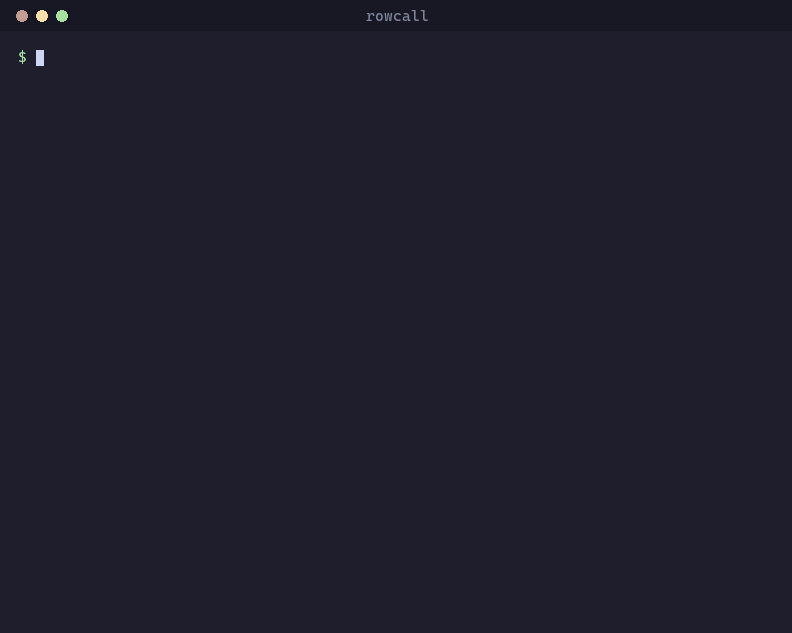

# rowcall

Make one API call per row of a CSV file, safely.

You have a spreadsheet of records and an API that only takes them one at a
time. rowcall fills in a request template for each row, checks every row
before anything is sent, asks before sending, and writes a results file you
can open in a spreadsheet.



## Install

Needs Python 3.10 or newer. From a copy of this repository:

```bash
python -m venv .venv
.venv/Scripts/activate        # macOS/Linux: source .venv/bin/activate
pip install .
```

## Try it

```bash
export DEMO_TOKEN=anything    # PowerShell: $env:DEMO_TOKEN = "anything"
rowcall run examples/jsonplaceholder/posts.csv \
  -t examples/jsonplaceholder/create-post.yaml --dry-run
```

The dry run checks every row and previews the first few requests. Secrets
from environment variables are shown as `****`. Nothing is sent.

Drop `--dry-run` to send for real. JSONPlaceholder is a free fake API, so
nothing is actually saved there. rowcall shows how many requests it is about
to send and where, and waits for you to type `yes` (or pass `--yes`).

## Safety

- **Every row is checked first.** If any row has a problem (for example an
  empty value), nothing is sent until you fix it, or pass `--skip-invalid` to
  send only the good rows.
- **You confirm before anything is sent.**
- **Secrets stay secret.** They come from environment variables, are masked in
  previews, and are replaced with `****` if an API echoes them back.
- **Results are written as each row finishes**, so if a run is interrupted you
  still know exactly which rows went through. Existing results files are never
  overwritten.
- **It goes at a polite pace.** At most 5 requests per second by default
  (`--rate`), retries included.
- **It retries only when retrying cannot do something twice.** See below.
- **Ctrl+C stops cleanly.** Every row still ends up in the results file: the
  one in progress is marked `interrupted` (check whether it went through) and
  the rest are marked `not_sent`.

## Retries

A failed request is retried (up to `--retries`, default 3) only when that is
safe:

| What happened | Retried? | Why |
|---------------|----------|-----|
| Could not reach the server | Always | The request never arrived |
| `429 Too Many Requests` or `503 Unavailable` | Always | The server says it did nothing |
| Timeout, dropped connection, `502`, `504` | Only GET, PUT, DELETE, HEAD, OPTIONS | The server may already have acted. Repeating these is harmless, but repeating a POST or PATCH could create duplicates |
| Any other error (`400`, `401`, `404`, `500`, ...) | Never | Trying again will not change the answer |

rowcall waits as long as the server's `Retry-After` header asks. Otherwise it
waits 1s, 2s, 4s, and so on. If the server asks for a wait longer than
`--max-wait` (default 60 seconds), rowcall gives up on that row and says why.

## Results file

Every input column, plus:

| Column | Meaning |
|--------|---------|
| `rowcall_line` | line number in the input CSV |
| `rowcall_outcome` | `sent_ok`, `sent_failed`, `skipped`, `interrupted`, or `not_sent` |
| `rowcall_status` | HTTP status code (blank if no response) |
| `rowcall_error` | what went wrong, if anything |
| `rowcall_response` | first 500 characters of the response |
| `rowcall_ms` | how long the last attempt took |
| `rowcall_attempts` | how many times the request was sent |

## Templates

```yaml
method: POST
url: https://api.example.com/users/{{user_id}}
headers:
  Authorization: Bearer ${API_TOKEN}
body:
  email: "{{email}}"
```

- `{{column}}` is filled in from the CSV row. Values in the URL are URL-encoded.
- `${NAME}` is filled in from an environment variable, so secrets never live
  in the template or the CSV.
- A mapping or list `body` is sent as JSON. A text `body` is sent as-is.
- A row with an empty value for a column the template uses is reported as a
  problem instead of being sent, so `DELETE /users/{{id}}` can never become
  `DELETE /users/`.

## Exit codes

| Code | Meaning |
|------|---------|
| 0 | every row is ready (dry run) or was sent successfully |
| 1 | some rows have problems, failed, or were skipped |
| 2 | the template, CSV, or settings need fixing before anything can run |
| 3 | you answered no at the confirmation prompt |
| 130 | stopped with Ctrl+C |

## Roadmap

1. [x] Templates and dry run
2. [x] Send requests and write a results CSV
3. [x] Rate limiting, retries (honoring `Retry-After`), clean stop on Ctrl+C
4. [x] Demo GIF and a first release (0.1.0)

## Later (not in version 1)

- Typed values in JSON bodies (today every `{{column}}` becomes a string)
- Resume a run from its results file
- OAuth sign-in flows, pagination, GraphQL, scheduling

## Development

```bash
pip install -e ".[dev]"
pytest
```

The tests send real HTTP requests to a small server they start on your own
machine, so they need no network access. To re-record the demo GIF after
changing the output:

```bash
pip install -e ".[demo]"
python scripts/make_demo_gif.py
```

## License

MIT
